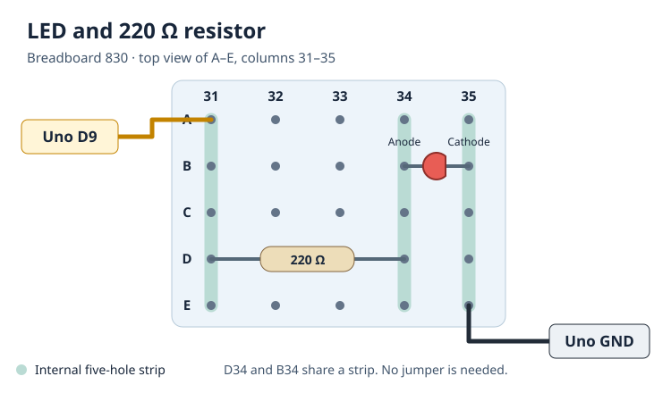

# MechaVision V2 — المرحلة الأولى

فرع التطوير `codex/mechavision-v2-development` يبدأ من تطبيق S22 العامل عند `d2b8249` ومن مواصفات V2. كانت النسخة الأولى ترسم أقواسًا بين نقاط مرئية، وتعرض مجسّمات من أشكال Unity البسيطة، وتعتمد علامة مطبوعة لتحديد وضع البورد. يظل تتبّع العلامة ومسار معايرة الإزاحة مستخدمين. تركز هذه المرحلة على التوصيل الكهربائي، وتبقى المجسّمات رموزًا تعليمية.

## البورد والمخطط المادي

يصف [قالب البورد](../Assets/Resources/MechaVision/breadboard_830.json) 630 ثقبًا في 63 عمودًا وعشرة صفوف A–J، و200 ثقب في أربعة قضبان جانبية. كل عمود له شريطان مستقلان، A–E وF–J. مرور مسار سلك فوق سلك آخر لا ينشئ اتصالًا. يتصل الطرف الداخلي عبر الثقب الذي يشغله، ويستخدم الجمبر ثقبًا شاغرًا من الشريط نفسه. المقاومات والصمامات والمحركات عناصر دائرة لها أطراف متمايزة، ولا يدمج نموذج الموصلات طرفيها.

يوضح [دليل ضبط ملف البورد](Breadboard-profile.md) الفرق بين المسافات الهندسية والانقطاعات الكهربائية. تمثل قيم 165 × 55 مم وتباعد 2.54 مم ومواقع القضبان قالبًا غير مقاس على البورد الفعلية. أصل الإحداثيات في منتصف سطح البورد، وX من العمود 1 إلى 63 وZ من A إلى J وY فوق السطح. يُسجل كل قضيب مصفوفة `cut_after` مستقلة. تستند أطوال ومواقع الأسلاك إلى القالب، وتستخدم الخطط الحالية شرائط التوصيل مع إبقاء قضبان التغذية غير المقاسة خارج التوصيلات.

يولّد [مخطط التجميع المادي](../Assets/Resources/MechaVision/physical_plans.json) من مخططات الكتالوج الأصلية. يسجل لكل مشروع مواضع القطع وإسناد الأرجل، الثقوب والموصلات الخارجية، نقاط انعطاف الأسلاك، الخطوات، وحالة تطابق شبكة التوصيل مع المخطط. المشاريع التي يتعذر تخطيطها تبقى قابلة للتصفح وقراءة الكود مع سبب عربي لغياب عرض التوصيل.

## دوائر مرجعية قابلة للفحص

| الدائرة | المخطط الناتج على قالب 830 | فحص ما قبل التغذية |
| --- | --- | --- |
| LED وUno | ساقا المقاومة D31 وD34، أنود LED في B34 والكاثود في B35. جمبر من Uno D9 إلى A31، وآخر من E35 إلى Uno GND. يربط الشريط العمود 34 بين D34 وB34. | افحص المقاومة 220 Ω والقطبية. يستخدم الكود D9. |
| HC-SR04 والبيزو | Uno 5V إلى VCC، وD7 إلى TRIG وECHO إلى D8 وD6 إلى البيزو. تستخدم شبكة الأرضي الثقوب H1 وI1 وJ1 في الشريط نفسه. | تحقّق من نسخة المستشعر 5 V والبيزو السلبي منخفض التيار. |
| السلة الذكية مع SG90 | يبقى السيرفو خارج البورد. يتصل VCC بمصدر مستقل وإشارة السيرفو بـD9. تتلاقى أرضي Uno والمستشعر والسيرفو والمصدر في موصّل خارجي WAGO 221-415 بأربعة منافذ مستخدمة وواحد احتياطي. | الموصّل متطلب إضافي للخطة. افحص ملاءمة إنهاء الأسلاك ومواصفات الموصل وتيار توقّف السيرفو. |



يبدأ مشهد TrackingProof بالتحضير ولا يعرض أسلاكًا. تعرض الخطوة 1 أماكن الأرجل، وتعرض الخطوة 2 جمبر D9، وتشرح الخطوة 3 الاتصال الداخلي بين D34 وB34، ثم تعرض الخطوة 4 جمبر الأرضي. يعرض وضع الدائرة الكاملة الجمبرين بوضوح، والرجوع منه يعيد ترتيب الظهور إلى الخطوة السابقة.

في [ملف المخططات](../Assets/Resources/MechaVision/physical_plans.json)، ابحث عن `led_resistor_demo` و`touchless_doorbell` و`smart_dustbin`. تضم السجلات `netlist` لمقارنة المجموعات الكهربائية، و`components` لإسناد الأرجل، و`connections` لنقاط المسارات، و`assembly_steps` لتوقيت عرضها. تتطابق شبكات الأمثلة الثلاثة في الفحص البرمجي. الرسم أعلاه مبني من مخطط الثقوب المولّد، وتجربة العرض الفعلية في Unity تنتظر الاختبار.

## دورة التحقق

نجحت اختبارات Python الـ44 ومقارنة الناتج المحفوظ بتوليد جديد. تولّدت 29 خطة متكافئة كهربائيًا وفق النموذج، منها 28 مشروعًا من الكتالوج وتجربة LED. بقيت 22 خطة غير متاحة بسبب الحاجة إلى توثيق توزيع تيار خارجي أو تحديد موضع ملائم لقطعة أو إيجاد مسار يلتف حول أجسام القطع. بقيت سجلات الكتالوج الخمسون وأكوادها كما هي. اجتاز مثال LED فحص صياغة C++ على المضيف، واجتازت ملفات C# فحص البنية النحوية.

```sh
python3 -m pip install -r Tools/requirements.txt
python3 Tools/build_catalog.py --check
python3 Tools/physical_plans.py --check
python3 -m unittest discover -s Tools -p 'test_*.py'
g++ -std=gnu++11 -fsyntax-only -x c++ -I Tools/host_arduino -include Arduino.h Examples/led_resistor_demo/led_resistor_demo.ino
```

تراجع الأداة تطابق مجموعات الموصلات في المخطط والواقع المولّد، وتشغل فحوصًا لقطبية LED والمقاومة التسلسلية وقصر مصادر التغذية وتعارض مخارج GPIO المعروفة في الكود. تُراجع طوبولوجيا تغذية أجهزة القيادة والسيرفو والأرضي المشترك. تبقى ملاءمة الجهد والتيار ومواصفات كل وحدة وتركيب الموصلات أخطارًا يجري التحقق منها مع المعلّم وعلى العتاد. فحص الصياغة يستخدم مترجم المضيف وتعريفات اختبارية ولا يقيس أداء الدائرة أو الذاكرة أو توافق AVR.

## إثبات القياسات على Windows وGalaxy S22

1. افصل التغذية ولا تضع أجزاء في البورد أثناء القياس. صوّر ترقيم الثقوب واتجاه A–J بعد تثبيت البورد والعلامة. قِس طول وعرض البورد وارتفاع سطحها عن العلامة. قِس المسافة بين مركزي ثقبين يبعدان عشرة أعمدة واقسم على عشرة. سجّل مواقع صفوف الثقوب والقضبان بالنسبة إلى المركز.
2. استخدم مقياس الاستمرارية لكل قضيب على حدة. سجّل كل انقطاع بين ثقبين متتاليين، وتحقّق من عزل القضبان ومن الفصل بين A–E وF–J. حدّث القالب بالمتر وبمواضع القطع المؤكدة ثم شغّل أداة توليد المخططات بدون `--check` وأعد الفحوص.
3. افتح جذر الفرع في Unity 6000.0.70f1 على Windows، وشغّل اختبارات EditMode من **Window → General → Test Runner**. في مشهد `Assets/Scenes/TrackingProof.unity` افحص وضع Play التجريبي، بدء التحضير بلا أسلاك، كل خطوة، الرجوع من الدائرة الكاملة إلى الخطوة نفسها، ثم فتح مشروع آخر. شغّل بناء Android حسب [دليل AR](AR-setup.md).
4. ثبّت APK على S22 وشغّل مشهد الدائرة. باستخدام [مصفوفة S22](S22-test-matrix.md)، قارن مراكز نقاط الأسلاك مع الثقوب المسماة عند تحريك الهاتف وحده، والبورد وحدها، وعند دورانها. غطّ العلامة، وحرّك البورد ثم اكشفها. سجّل أكبر انحراف بالملليمتر وتأخّر الاختفاء وإعادة المحاذاة، والتحقّق من عدم ظهور أي سلك من خطوة لاحقة.
5. لاختبار الدائرة اعزل الطاقة أولًا. افحص الاستمرارية حسب جدول الثقوب، وقِس المقاومة، وتحقّق من اتجاه LED، ثم حمّل [مثال D9](../Examples/led_resistor_demo/led_resistor_demo.ino) واختبر الوميض بإشراف المعلّم. افحص HC-SR04 والبيزو والسيرفو بصورة مستقلة، ودوّن نوع كل وحدة وجهدها وطريقة تغذيتها قبل توصيلها.

حالة التحقق على السحابة: Unity وArduino CLI والهاتف غير متاحة. اختبارات EditMode وبناء APK وقياسات البورد على الهاتف وتجميع AVR وتشغيل الدوائر الفعلية تنتظر بيئة الاختبار على الجهاز. لا تُرقّى سجلات تعليمية إلى حالة مراجعة أو اعتماد بناءً على اختبارات التخطيط الآلية.
